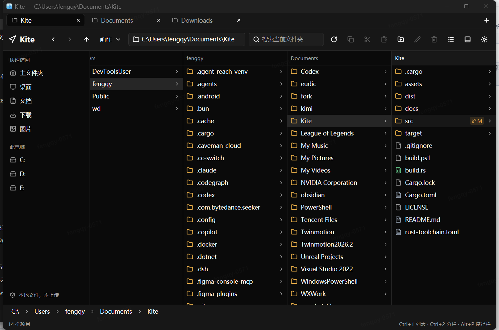
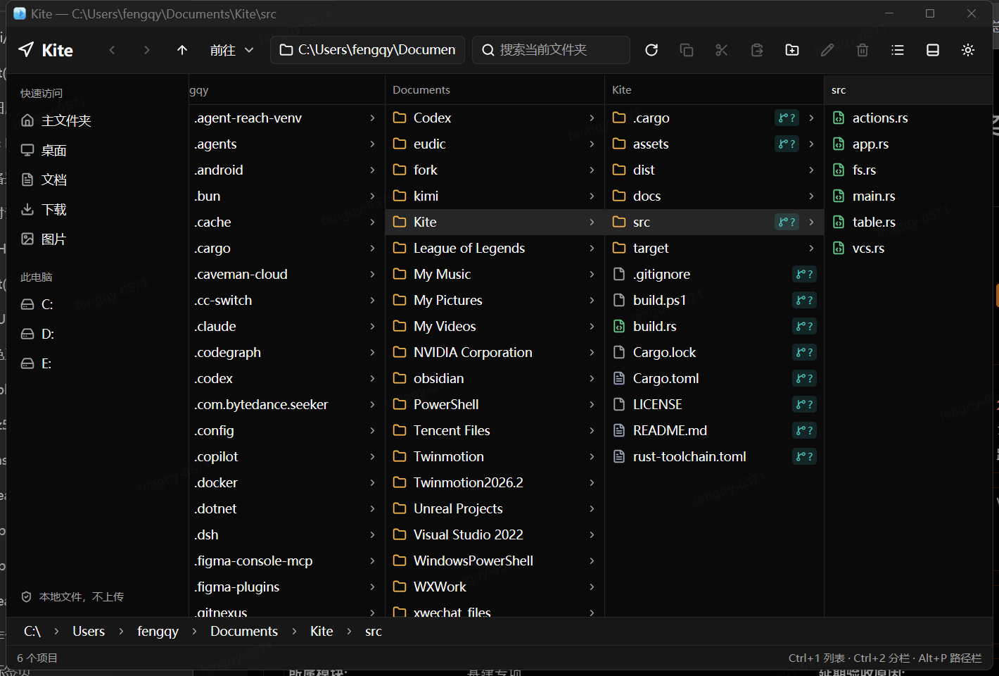
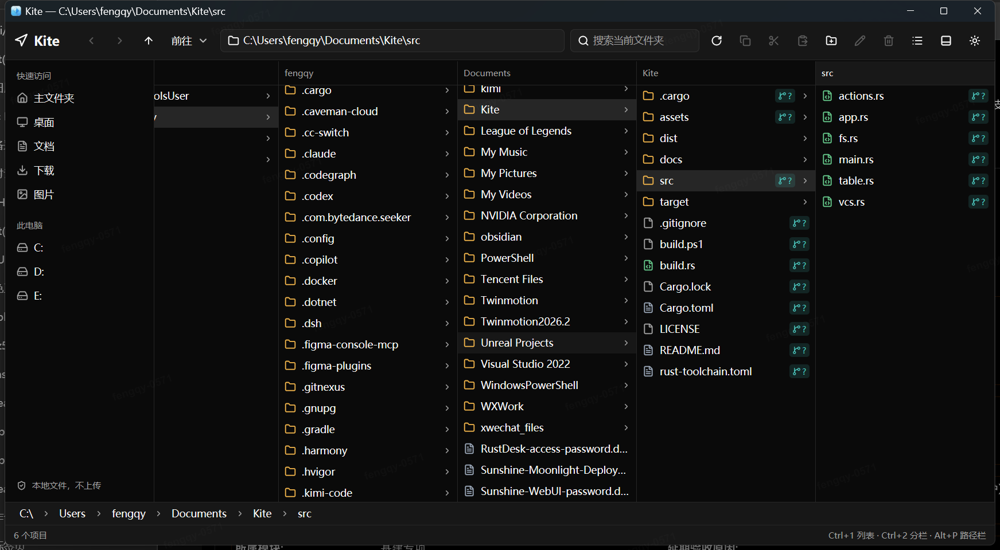
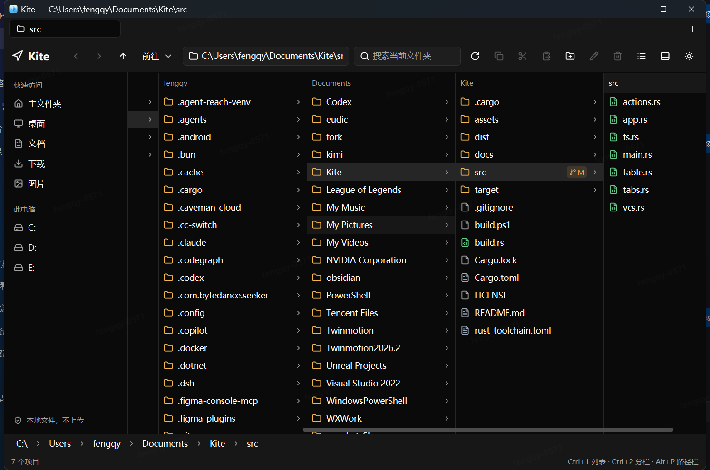
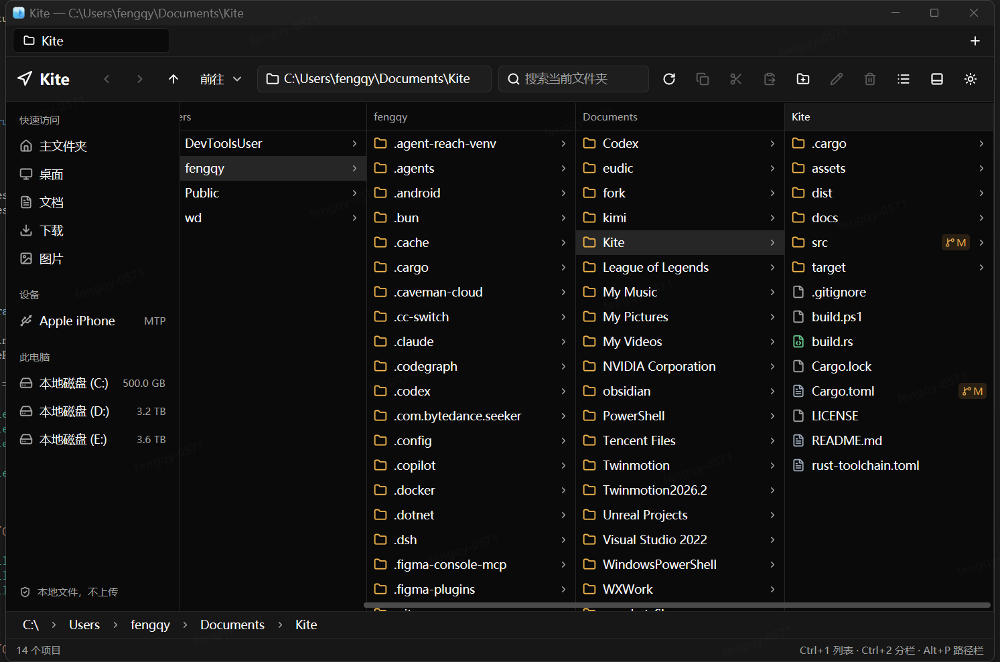
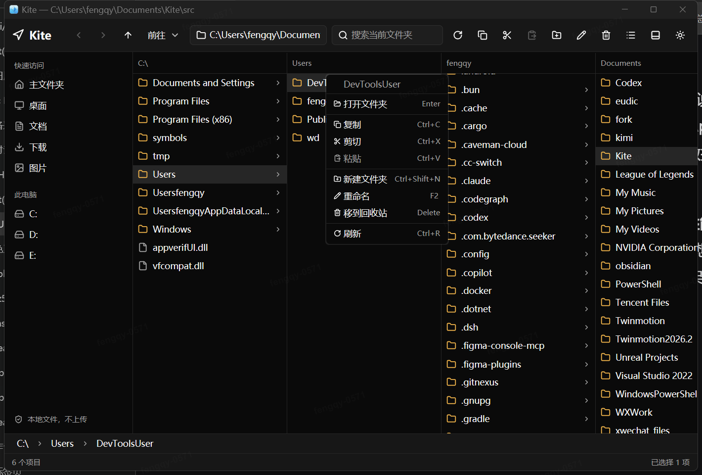

# Kite

Kite 是一个 Windows 原生文件管理器。Kite 使用 Rust 和 GPUI 构建。

GPUI 是 Zed 的 GPU 界面框架。Kite 的窗口、输入、表格和主题都由 GPUI 渲染。

## Screenshots

### Tabbed workspace



### Column view



### Wide hierarchy



### Horizontal column scrolling



### Device detection



### Context menu



## 当前能力

- 浏览本机文件夹。
- 使用多个页签替换多个窗口。
- 工具栏不重复显示应用图标和应用名。
- 识别 USB 存储设备、可移动磁盘和 WPD/MTP 便携设备。
- 使用侧边栏访问主文件夹、桌面、文档、下载、图片和本机驱动器。
- 使用并排分栏浏览多级文件夹。
- 分栏导航只加载新增或缺失的层级。
- 使用可点击路径栏返回任意上级文件夹。
- 使用“前往”菜单返回上级或输入路径。
- 使用地址栏打开绝对路径或相对路径。
- 使用返回、前进和上一级按钮导航。
- 按名称、修改日期、类型和大小排序。
- 递归搜索当前文件夹。
- 双击文件夹进入下级文件夹。
- 双击文件调用 Windows 默认程序打开文件。
- 新建文件夹、重命名和移到回收站。
- 复制、剪切和粘贴文件或文件夹。
- 右键文件行打开操作菜单。
- 在右键菜单中执行 Git 和 SVN 操作。
- 显示 Git 和 SVN 状态徽标。
- 在浅色主题和深色主题之间切换。
- 过滤 Windows 隐藏属性和系统属性的项目。

## 右键菜单

右键文件行后，Kite 先选中该行，再显示操作菜单。

菜单支持以下操作：

- 打开
- 复制
- 剪切
- 粘贴
- 新建文件夹
- 重命名
- 移到回收站
- 刷新

在 Git 工作区中，菜单增加 Git 添加、Git 提交和 Git 还原。
在 SVN 工作副本中，菜单增加 SVN 更新、SVN 添加、SVN 提交和 SVN 还原。

菜单显示对应快捷键。

## 版本控制状态

Kite 在“版本控制”列显示 Git 和 SVN 状态。Git 使用分支图标。SVN 使用堆叠图标。

| 代码 | 含义 |
| --- | --- |
| `M` | 已修改 |
| `A` | 已新增 |
| `D` | 已删除 |
| `R` | 已重命名 |
| `?` | 未跟踪 |
| `!` | 已忽略或缺失 |
| `C` | 存在冲突 |
| `P` | 属性已修改 |
| `X` | 外部项目 |

文件夹显示子项目中优先级最高的状态。冲突、缺失和删除状态的优先级最高。

状态查询在后台任务中执行。命令不可用或目录不属于工作副本时，状态列保持空白。

Kite 需要 `git` 和 `svn` 在 `PATH` 中。缺少对应命令时，Kite 不显示对应状态。

### Git 与 SVN 操作

Kite 只在 Git 工作区显示 Git 操作。Kite 只在 SVN 工作副本显示 SVN 操作。

Git 和 SVN 始终显示在右键菜单的一级菜单中。
子菜单在非对应工作区中保持可见，操作项显示为禁用。

Git 子菜单支持添加、取消暂存、提交、拉取、推送、获取、还原和清理工作区。
Git 提交使用所选路径的已暂存更改。

SVN 子菜单支持更新、添加、提交、锁定、解锁、还原和清理工作副本。
SVN 提交提交所选路径的本地更改。

提交操作要求输入提交说明。还原操作要求确认。
命令在后台任务中执行。旧文件状态不会阻塞界面。

## 分栏视图与路径栏

Kite 默认使用分栏视图。每一栏显示一级文件夹的内容。
选中文件夹后，Kite 在右侧加载下一栏。

Kite 不设置固定栏数上限。
窗口宽度决定同时可见的栏数。
窗口变窄时，深层栏目保留在横向滚动区域中。
使用触控板横向滚动或拖动分栏底部滚动条即可查看。

路径栏显示当前项目的完整路径。
点击任意文件夹段可返回对应层级。
点击路径栏时，Kite 复用已加载的上级栏目。未变化的栏目不重新加载。

Windows 使用 `Alt+P` 切换路径栏。
该快捷键对应 macOS 的 Option 组合键。

名称列和分栏列表都显示 Git/SVN 状态徽标。

## 前往菜单

工具栏的“前往”菜单支持两个操作：

- “上层文件夹”打开父目录。
- “前往文件夹…”打开路径输入框。

路径输入支持绝对路径和相对路径。
`~` 表示个人文件夹。
`/` 表示当前磁盘根目录。

## 多页签

Kite 使用一个窗口承载多个页签。
每个页签保留独立的路径、历史、分栏、搜索和视图状态。
文件剪贴板由同一窗口的全部页签共享。

新建页签打开当前页签的文件夹。
最后一个页签不能关闭。

页签栏右侧的 `+` 按钮新建页签。
页签的 `×` 按钮关闭页签。

## 设备识别

Kite 在侧边栏显示已连接的存储设备和便携设备。
USB 存储设备通过存储总线类型识别。
可移动磁盘显示卷名称、盘符和总容量。
设备列表每 2 秒自动刷新。

USB 存储设备可直接浏览。
WPD/MTP 便携设备当前只支持识别和显示。
WPD/MTP 文件浏览尚未支持。

## 快捷键

| 快捷键 | 操作 |
| --- | --- |
| `Alt+Left` | 返回 |
| `Alt+Right` | 前进 |
| `Alt+Up` | 上一级 |
| `Ctrl+L` | 聚焦地址栏 |
| `Ctrl+F` | 聚焦搜索框 |
| `Ctrl+1` | 切换到列表视图 |
| `Ctrl+2` | 切换到分栏视图 |
| `Ctrl+T` | 新建页签 |
| `Ctrl+W` | 关闭页签 |
| `Ctrl+Tab` | 下一个页签 |
| `Ctrl+Shift+Tab` | 上一个页签 |
| `Alt+P` | 显示或隐藏路径栏 |
| `Ctrl+Shift+G` | 前往文件夹 |
| `Enter` | 打开选中项目 |
| `F2` | 重命名选中项目 |
| `Delete` | 将选中项目移到回收站 |
| `Ctrl+C` | 复制选中项目 |
| `Ctrl+X` | 剪切选中项目 |
| `Ctrl+V` | 粘贴 |
| `Ctrl+Shift+N` | 新建文件夹 |
| `Ctrl+R` | 刷新 |
| `Esc` | 关闭弹窗或清除搜索 |

## 性能设计

- 文件夹读取在后台任务中执行。界面线程不等待磁盘响应。
- 分栏导航复用已加载的公共上级栏目。
- 进入下一层时，上级栏目不进入加载状态。
- 跳转其他分支时，只加载公共前缀之后的栏目。
- 导航请求带有代号。旧请求的结果不会覆盖新文件夹。
- 搜索使用可取消的后台任务。搜索有 1000 个结果上限。
- 文件表格只绘制可见行。大文件夹不会创建同等数量的界面元素。
- 搜索和导航共享排序规则。排序不触发磁盘读取。
- 文件操作在后台任务中执行。界面保持响应。

## 稳定性设计

- 读取失败时保留原文件夹内容。
- 不可读取的项目会计入跳过数量。单个坏项目不终止文件夹读取。
- 隐藏的系统联接点不会显示为普通文件夹。
- 受保护文件夹显示明确权限提示，不显示原始 Windows 错误码。
- 复制冲突自动生成“ - 副本”名称。复制操作不覆盖已有项目。
- 文件夹不能复制到自身内部。
- 删除操作使用 Windows 回收站。
- 删除前显示确认提示。
- 操作错误显示在状态栏。
- 文件层包含路径、排序、搜索、格式化和复制测试。

## 图标设计

图标使用浅蓝天空色玻璃底板。
风筝使用半透明翼面、柔和高光、蓝色阴影和珠光风筝线。
图标没有黑色背景。

图标母版为 `assets/kite-icon-master.png`。
ICO 包含 16、24、32、48、64、128 和 256 像素尺寸。

重新生成图标：

```powershell
py -m pip install pillow
py .\assets\generate_icon.py
.\build.ps1
```

## 当前限制

- 文件表格当前支持单选。
- 复制和剪切使用 Kite 内部剪贴板。内部剪贴板在同一窗口的页签之间共享。Kite 当前不与 Windows 资源管理器共享文件剪贴板。
- 复制操作不支持符号链接。
- 搜索只匹配项目名称。
- 搜索显示前 1000 个匹配项目。
- 表格空白区域尚未提供右键菜单。
- 当前版本没有自定义列布局。
- Git/SVN 状态只覆盖当前视图和当前视图的子项目。
- WPD/MTP 便携设备当前不支持文件浏览。
- Git 和 SVN 认证使用本机凭据缓存，不显示交互式登录窗口。

## 构建

### 环境

1. 安装稳定版 Rust。
2. 安装 Visual Studio 2022 C++ 生成工具。
3. 安装 Windows 10 或 Windows 11 SDK。
4. 确认 `cargo` 和 `rustc` 在 `PATH` 中。

### 开发运行

```powershell
cargo run
```

Kite 接受一个可选的启动文件夹：

```powershell
cargo run -- "C:\Work\Project"
```

### 发布构建

```powershell
.\build.ps1
```

`build.ps1` 生成 `dist\Kite.exe` 和 `dist\Kite-v0.3.4-windows-x64.zip`。

### 测试

```powershell
cargo test
cargo clippy --all-targets -- -D warnings
```

## 项目结构

- `src/app.rs`：页签内容、导航状态、剪贴板、文件操作和界面。
- `src/app/devices.rs`：USB 卷、存储设备属性和 WPD 设备枚举。
- `src/tabs.rs`：窗口页签栏、页签切换和窗口级共享剪贴板。
- `src/fs.rs`：文件夹读取、搜索、排序、格式化、复制和回收站操作。
- `src/table.rs`：虚拟文件表格和列定义。
- `src/main.rs`：应用入口、主题和窗口创建。
- `build.rs`：Windows 图标和版本资源。
- `assets/kite.ico`：应用图标。

## 技术栈

- Rust 2024 Edition
- GPUI `0.2.2`（由 `gpui-kit 0.8.0` 固定）
- GPUI Kit `0.8.0`
- Windows API
- WalkDir
- trash

## 许可

MIT
