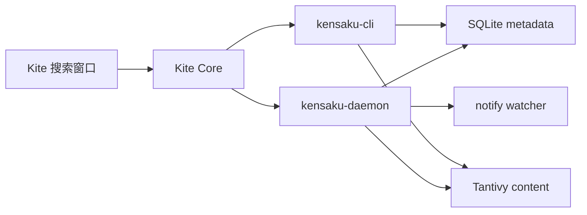
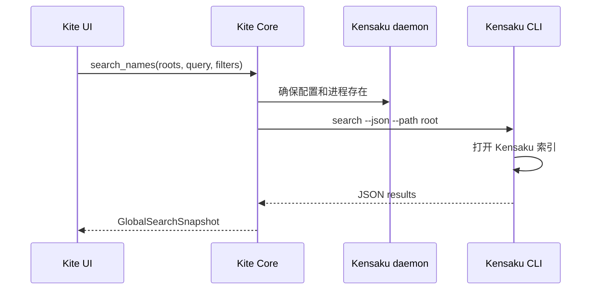

# 全局名称与内容搜索

> 结论：Kite 的全局名称搜索和全局内容搜索完全使用 Kensaku。Kite 启动 Kensaku daemon，daemon 负责首次扫描、监听和增量更新。Kite 不再建立自己的全局名称索引、USN 游标、Spotlight 加速器或内容索引。

状态：已实现
日期：2026-11-09

## 1. 能力

用户通过独立窗口执行全局搜索。

- Windows 使用 `Ctrl+Shift+F` 打开窗口。
- macOS 使用 `Command+Shift+F` 打开窗口。
- 窗口支持“名称”和“内容”模式。
- 范围支持当前文件夹、收藏夹、本地磁盘和网络卷。
- 名称结果按 Kensaku 排序结果转换。
- 内容结果按 Kensaku 匹配片段转换。
- 类型和时间过滤继续由 Kite 应用。
- 双击结果打开文件。

## 2. 进程模型



职责：

| 组件 | 职责 |
| --- | --- |
| `kensaku-daemon` | 首次扫描、监听、增量更新、内容提取和索引写入 |
| `kensaku-cli` | 只读搜索和状态查询 |
| Kite Core | 启动 daemon、传递根目录、转换结果和应用 UI 过滤 |
| Kite UI | 展示结果、取消搜索和处理打开动作 |

## 3. 数据流



内容搜索使用相同流程。内容结果表明 Kensaku 匹配片段。

## 4. Sidecar 生命周期

Kite 发现 `kensaku-cli` 和 `kensaku-daemon`。

发现顺序：

1. 环境变量。
2. Kite 可执行文件目录。
3. `PATH`。

Kite 使用独立数据目录：

```text
<Kite local data>/kensaku
```

Kite 写入最小 `config.json`。配置包含 `watched_dirs` 和 `is_setup_complete=true`。

新根目录不在配置中时，Kite 执行以下动作：

1. 停止 Kite 管理的旧 daemon。
2. 合并根目录。
3. 重启 daemon。

## 5. 查询语义

名称模式把输入转换为 Kensaku `name:` 查询。

内容模式把输入直接传给 Kensaku。正则模式转换为 `re:` 查询。

Kite 对每个根目录调用一次 CLI。Kite 合并结果并去重。

类型和时间过滤在 Kite Core 中执行。过滤在最终结果上限前执行。

## 6. 内容结果转换

Kensaku 搜索响应提供匹配片段。Kensaku 搜索响应不提供完整行号。

Kite 根据片段在文件中查找行号。文件超过 8 MiB 或片段无法定位时，Kite 使用片段文本作为兼容行结果。

该转换是兼容层。权威上下文应通过 Kensaku MCP `read_snippet` 获取。

## 7. 取消和限制

- 名称搜索支持取消。
- 内容搜索支持取消。
- CLI 搜索超时 20 秒。
- CLI 状态超时 5 秒。
- CLI 输出上限 16 MiB。
- Windows 隐藏 CLI 和控制台窗口。
- 全局搜索结果上限保持 1000 项。
- 内容结果上限保持 50 个文件。

## 8. 删除的 Kite 实现

以下模块已经删除：

- `src/name_index.rs`
- `src/usn_journal.rs`
- `src/indexed_search.rs`
- 旧 `src/content_search.rs` 索引实现

`src/content_search.rs` 现在只保留 DTO 和 Kensaku 门面。

`src/global_name_search.rs` 现在只保留 Kensaku 门面。

## 9. 保留的 Kite 搜索

以下功能继续使用 Kite Core：

- 分栏内小目录递归搜索。
- 路径导航。
- 文件预览。
- 文件操作。
- VCS 状态。

## 10. 已知限制

- Kensaku daemon 需要打包 sidecar。
- Kensaku daemon 的首次索引需要时间。
- Kite 不修改 Kensaku 内部 schema。
- Kite 内容行号是兼容转换结果。
- Kensaku CLI 与 daemon 的协议升级需要同步验证。
