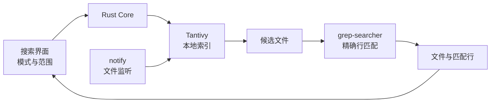

# 全局名称与内容搜索

> 结论：Kite 使用有界遍历搜索名称。Kite 使用 Tantivy 本地索引查找内容候选文件。Kite 使用 `grep-searcher` 验证精确文本并生成匹配行。后台任务始终让位于前台交互。

状态：已实现
日期：2026-11-05
关联调研：[Rust 搜索引擎调研](../RUST_SEARCH_ENGINE_RESEARCH.md)

## 1. 能力

用户通过独立窗口执行全局搜索。
Windows 使用 `Ctrl+Shift+F` 打开窗口。
macOS 使用 `Command+Shift+F` 打开窗口。
窗口内可切换“名称”和“内容”模式。
名称和内容模式都支持当前文件夹、收藏文件夹、本地磁盘和网络卷。
本地磁盘包含系统报告的固定磁盘、USB 和可移除磁盘。
网络卷单独选择，避免不可用的远程路径拖慢本地搜索。
名称搜索只使用一个遍历线程，并跳过隐藏项和生成目录。
内容结果按文件分组。
名称结果按精确匹配、路径深度和开发路径优先级排序。
同名同类型结果默认折叠为一个位置，用户可以展开其他位置。
每个名称结果显示完整父路径、类型、大小和修改时间。
每个内容结果显示路径、大小、修改时间、匹配次数和匹配行。
匹配行高亮搜索结果文字。
双击结果打开文件。

内容搜索当前支持 UTF-8 和 ASCII 文本。
内容搜索不解析 PDF、Office 文档、压缩包或 OCR 内容。
内容搜索不跟随符号链接。

## 2. 数据流



内容快路径查询只读取索引和少量候选文件。
内容查询不遍历整个磁盘。
名称查询只在选定的根目录内遍历。
候选文件验证失败时，Kite 跳过该文件。
Kite 同时把该文件加入索引更新队列。

## 3. 索引结构

索引目录位于应用本地数据目录。

```text
Kite/search-index-v1/
```

索引字段如下。

| 字段 | 用途 |
| --- | --- |
| `path_key` | 规范化路径、删除和范围过滤 |
| `path` | 显示完整路径 |
| `root_key` | 索引根目录 |
| `root` | 显示根目录 |
| `name` | 文件名 |
| `size` | 文件大小 |
| `modified_ms` | 修改时间 |
| `body` | 小写文本词项 |

索引不保存完整正文。
索引只保存词项和文件元数据。
匹配片段从原文件读取。
这样可减少索引体积和重复内容。

## 4. 查询

单词语查询使用词项正则查询。
多词语查询使用短语查询。
查询默认不区分大小写。
Rust Core 也接受正则查询。
正则查询使用实时扫描回退，不承诺索引级延迟。

索引返回候选文件后，Rust Core 执行以下步骤。

1. 检查文件仍然存在。
2. 检查文件大小没有超过 8 MiB。
3. 使用 `grep-searcher` 生成精确匹配。
4. 保留最多 3 条匹配行。
5. 按匹配行数、修改时间和相对路径排序。

每次查询最多返回 50 个文件。
每个文件最多统计 10000 条匹配行。
界面显示结果截断和索引更新状态。

名称查询最多返回 1000 项。
名称查询最多扫描 250000 项或 5 秒。
达到扫描上限时，结果标记为不完整。
多磁盘范围只在按 Enter 或点击搜索后执行。
当前文件夹范围支持输入停顿后的自动查询。
精确名称和精确文件主名排在最前。
目标路径相同且匹配质量相同时，`trunk`、`main`、`master`、`develop` 路径优先。
`publish`、`release`、`build`、`dist`、`archive` 和缓存路径排在其后。

## 5. 搜索范围

Kite 支持以下范围。

| 范围 | 行为 |
| --- | --- |
| 当前文件夹 | 搜索当前目录子树 |
| 收藏文件夹 | 搜索目录型收藏项 |
| 本地磁盘 | 搜索已枚举的固定、USB 和可移除卷 |
| 网络卷 | 搜索已枚举的网络卷 |
| 自定义多根范围 | Core API 接受多个根目录 |

范围先规范化，再删除重复根目录。
被父范围包含的子范围会被删除。
查询使用路径前缀过滤。
因此同一文件不会重复出现。

## 6. 增量更新

`notify` 监听所有索引根目录。
监听为递归模式。

事件处理如下。

| 事件 | 行为 |
| --- | --- |
| 创建文件 | 读取并加入索引 |
| 修改文件 | 比较大小和修改时间后重新索引 |
| 删除文件 | 删除索引文档 |
| 重命名文件 | 删除旧文档并加入新文档 |
| 创建目录 | 递归扫描新目录 |
| 删除目录 | 删除该路径下的索引文档 |

启动时加载已有索引元数据。
Kite 扫描根目录时只读取变化文件的正文。
未变化文件只比较元数据。
扫描完成后删除范围内的过期文档。

## 7. 默认排除规则

以下内容默认不索引。

- 隐藏项。
- `.git`、`.svn`、`.hg`。
- `node_modules`、`target`、`build`、`dist`、`.cache`。
- macOS 的 `Library`。
- Windows 的 `Windows`、`Program Files`、`ProgramData` 和回收站。
- 系统卷信息目录。
- 云盘占位文件。
- 超过 8 MiB 的文件。
- 二进制文件和非 UTF-8 文本。
- 符号链接。
- Kite 自己的索引和应用数据目录。

## 8. 资源保护

索引任务使用独立低优先级线程。
Tantivy 写入器只使用 1 个工作线程。
Tantivy 写入缓冲为 64 MiB。
索引每 100 个文档或每 1 秒提交一次。
查询开始时暂停索引。
用户输入时给予 650 ms 的索引暂停窗口。
低功耗模式或严重热压力时暂停索引。
macOS 使用 `ProcessInfo` 读取低功耗和热状态。
Windows 使用系统电源状态读取节电模式。
索引每处理一个文件后休眠 1 ms。
可用内存低于 128 MiB 时暂停索引。
索引磁盘剩余空间低于 256 MiB 时暂停索引。

资源上限如下。

| 资源 | 上限 |
| --- | --- |
| 单文件大小 | 8 MiB |
| 索引文件数 | 250000 |
| 查询结果数 | 50 文件 |
| 每文件片段数 | 3 行 |
| 片段长度 | 400 字符 |
| 索引写入缓冲 | 64 MiB |
| 每文件匹配统计 | 10000 行 |

## 9. 冷启动

索引在后台建立。
索引提交后立即可查。
索引未完成时，Rust Core 并行执行短时实时预览。
实时预览使用 2 个遍历线程和 350 ms 预算。
正则预览使用 500 ms 预算。
预览结果标记为部分结果。
后台索引继续构建。

## 10. 隐私

索引只在本地生成。
索引不上传网络。
索引没有远程服务进程。
索引目录只使用当前用户权限。
用户可调用清除索引接口删除全部索引文档。
用户移除范围后，应用可清理对应索引数据。

## 11. 平台接入

| 文件 | 职责 |
| --- | --- |
| `src/content_search.rs` | 索引、查询、片段、监听和资源控制 |
| `src/ffi.rs` | UniFFI 请求、状态和结果 |
| `src/global_search_window.rs` | Windows 独立搜索窗口 |
| `src/app.rs` | Windows 全局搜索入口和快捷键 |
| `apps/macos/Sources/KiteModel.swift` | macOS 搜索状态、范围和异步调用 |
| `apps/macos/Sources/KiteGlobalSearchWindow.swift` | macOS 独立搜索窗口 |
| `apps/macos/Sources/KiteColumnBrowser.swift` | macOS 搜索结果视图 |
| `apps/macos/Sources/ContentView.swift` | macOS 搜索模式和范围入口 |

## 12. 测试

Core 测试覆盖以下场景。

1. 索引内容查询。
2. 多根名称查询、路径排序和生成目录剪枝。
3. 中文内容查询。
4. 精确行号和匹配片段。
5. 多根范围去重。
6. 二进制文件跳过。
7. 文件变化后增量更新。
8. FFI 内容搜索结果转换。

CI 还运行 Rust 格式检查、全部 Core 测试、Clippy、Windows 构建和 macOS 应用构建。

## 13. 已知限制

- 内容搜索只支持 UTF-8 和 ASCII 文本。
- 搜索窗口支持当前文件夹、收藏文件夹、本地磁盘和网络卷。Core 也支持自定义多根范围。
- 当前文件夹范围在输入两个及以上字符后，等待 280 ms 自动查询。
- 多磁盘范围只在按 Enter 或点击搜索后查询。
- 名称搜索最多扫描 250000 项或 5 秒。
- 名称搜索不读取文件内容。
- 名称搜索不进入隐藏目录和生成目录。
- 内容搜索结果为每个文件保留 3 条片段。
- 文件名搜索和内容搜索使用不同结果模型。
- 索引首次建立需要后台时间。
